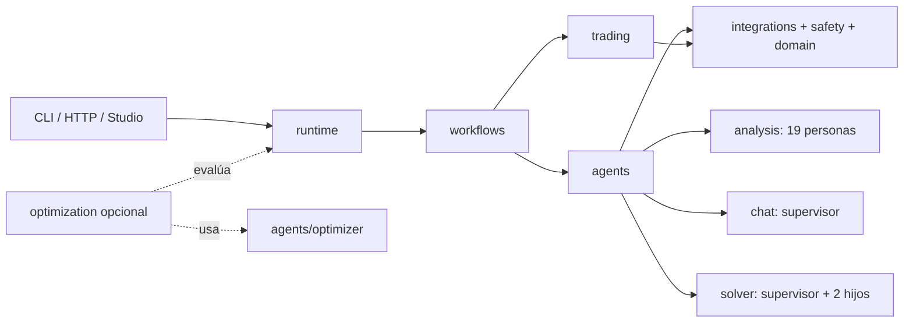

# Arquitectura multiagente de `fin-graph`

La organización separa cinco responsabilidades: agentes que deciden con modelos, workflows que
controlan transiciones, runtime que ensambla la aplicación, trading determinista y optimización
opcional. Así se puede seguir una ejecución desde su entrada hasta su salida sin confundir un nodo
de LangGraph con un agente DeepAgents.



## Dónde está cada cosa

| Pregunta | Ubicación |
|---|---|
| ¿Qué agentes existen? | [`agents/README.md`](../src/fin_graph/agents/README.md) y `fin-graph agents list` |
| ¿Cómo funciona el equipo de 19 personas? | [`agents/analysis`](../src/fin_graph/agents/analysis/README.md) |
| ¿Cómo conversa y propone órdenes? | [`agents/chat`](../src/fin_graph/agents/chat/README.md) |
| ¿Cómo delega el piloto asíncrono? | [`agents/solver`](../src/fin_graph/agents/solver/README.md) |
| ¿Qué hace el proposer opcional? | [`agents/optimizer`](../src/fin_graph/agents/optimizer/README.md) |
| ¿Quién controla estados y transiciones? | [`workflows`](../src/fin_graph/workflows/README.md) |
| ¿Quién construye el grafo productivo? | [`runtime`](../src/fin_graph/runtime/README.md) |
| ¿Dónde vive better-harness? | [`optimization`](../src/fin_graph/optimization/README.md) |

## DeepAgents frente a LangGraph

DeepAgents se usa en los supervisores y agentes delegables. Sus fábricas reales están solamente
bajo `fin_graph.agents` y todas aparecen en `agent_catalog()`. El catálogo es metadato de navegación:
consultarlo no crea un modelo, no abre integraciones y no inicia una ejecución.

LangGraph se usa para control durable: checkpoints, streaming, ramas paralelas, interrupciones de
aprobación y rutas de error. `workflows.analysis`, `workflows.orders` y `workflows.market_watch`
describen esas máquinas de estado. Los servicios de modelo se inyectan; el workflow conserva el
control de presupuestos, evidencia y cierre.

## Recorridos de producto

### Análisis nativo

`runtime.analysis` construye `workflows.analysis`. El workflow normaliza la solicitud, reúne
evidencia, ejecuta especialistas, sintetiza tesis y verifica citas. Puede usar servicios nativos o
el equipo de personas cuando un adaptador lo solicita.

### Equipo compatible de 19 personas

`analysis.persona_team` construye un supervisor DeepAgents y 19 agentes de dominio derivados del
catálogo financiero. La traducción de entradas/salidas de la aplicación de referencia pertenece a
su adaptador, no a los agentes.

### Chat y órdenes paper

`chat.supervisor` consulta integraciones y memoria. Una propuesta de orden pasa siempre por
`trading.order_desk` y `workflows.orders`; el modelo no puede saltarse límites ni aprobación.

### Solver acotado

`solver.supervisor` es un ejemplo mínimo: solo dos hijos, fixtures sintéticos, herramientas de
lectura y límites estrictos. Resulta útil para entender delegación asíncrona sin cargar todo el
producto.

### Optimización opcional

`optimization.harness` evalúa superficies congeladas y usa `agents.optimizer` como proposer. No se
importa desde runtime, workflows, agentes de producto o servidor. Sus candidatos requieren revisión
y nunca se adoptan automáticamente.

## Inspección rápida

```powershell
uv run fin-graph agents list
uv run fin-graph agents describe analysis.persona_team
uv run fin-graph harness runtime
```

Los dos primeros comandos son de solo lectura y no llaman a un LLM. El último muestra la huella y
los límites efectivos del runtime instalado.
