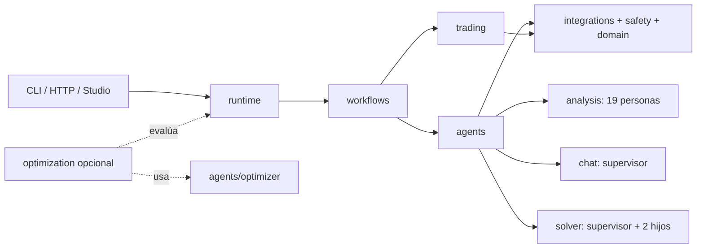

# Arquitectura multiagente de `fin-graph`

La organización separa cinco responsabilidades: agentes que deciden con modelos, workflows que
controlan transiciones, runtime que ensambla la aplicación, trading determinista y optimización
opcional. Así se puede seguir una ejecución desde su entrada hasta su salida sin confundir un nodo
de LangGraph con un agente Deep Agents.

## Veredicto: qué significa “full Deep Agents”

Todo loop autónomo dirigido por un modelo bajo `src/fin_graph` resuelve su construcción a
`deepagents.create_deep_agent`. No queda ninguna importación o llamada de proyecto a
`langchain.agents.create_agent`. Esto unifica el arnés de agencia; no elimina LangChain ni
LangGraph, dependencias sobre las que Deep Agents construye y ejecuta sus agentes.

El límite se aplica solo donde el modelo decide. Los grafos de routing, orden, aprobación, fan-out,
checkpoints, compare-and-swap (CAS) y ledgers de efectos forman el control plane determinista y no
son agentes autónomos. Convertir esas invariantes en decisiones del modelo queda fuera del diseño.



## Dónde está cada cosa

| Pregunta | Ubicación |
|---|---|
| ¿Qué agentes existen? | [`agents/README.md`](../src/fin_graph/agents/README.md) y `fin-graph agents list` |
| ¿Cómo funciona el equipo de 19 personas? | [`agents/analysis`](../src/fin_graph/agents/analysis/README.md) |
| ¿Cómo conversa y propone órdenes? | [`agents/chat`](../src/fin_graph/agents/chat/README.md) |
| ¿Cómo delega el piloto asíncrono? | [`agents/solver`](../src/fin_graph/agents/solver/README.md) |
| ¿Qué hace el proposer opcional? | [`agents/optimizer`](../src/fin_graph/agents/optimizer/README.md) |
| ¿Quién controla estados y transiciones? | [`workflows`](../src/fin_graph/workflows/README.md) |
| ¿Quién construye el grafo productivo? | [`runtime`](../src/fin_graph/runtime/README.md) |
| ¿Dónde vive better-harness? | [`optimization`](../src/fin_graph/optimization/README.md) |

## Deep Agents frente a LangGraph

Las construcciones model-driven se concentran en estos puntos:

| Contrato | Implementación |
|---|---|
| Agente restringido común y `analysis.native_react` | `src/fin_graph/agents/common/factory.py:make_agent` |
| Narradores de las 19 personas | `src/fin_graph/agents/analysis/persona_team.py:make_persona_agent` |
| Supervisor de chat | `src/fin_graph/agents/chat/supervisor.py:make_chat_graph` |
| Supervisor e hijos del solver | `src/fin_graph/agents/solver/supervisor.py` |
| Proposer opcional con workspace virtual | `src/fin_graph/agents/optimizer/proposer.py:make_optimizer_agent` |

`make_agent` es la seam restringida para agentes pequeños. Sin opt-in, Deep Agents recibe solo las
tools del llamador: los slots aditivos de filesystem/shell y `task` síncrona se reemplazan por
middleware sin herramientas. Esto mantiene una allowlist financiera aun cuando el arnés conserva
estado, resumen automático, parcheo de llamadas y caché de prompts.

El catálogo es metadato de navegación: consultarlo no crea un modelo, no abre integraciones y no
inicia una ejecución. Ya no admite la clase `langchain_agent`; `analysis.native_react` está
clasificado como `deepagents_subagent`.

LangGraph se usa para control durable: checkpoints, streaming, ramas paralelas, interrupciones de
aprobación y rutas de error. `workflows.analysis`, `workflows.orders` y `workflows.market_watch`
describen esas máquinas de estado. Los servicios de modelo se inyectan; el workflow conserva el
control de presupuestos, evidencia y cierre.

Ejemplos concretos del control plane son el fan-out explícito con `Send` en
`src/fin_graph/workflows/analysis/graph.py`, la secuencia prepare/approve/execute/verify de
`src/fin_graph/workflows/orders/graph.py`, el CAS de la cartera paper en
`src/fin_graph/persistence/paper_ledger.py`, y el ledger SQLite que abre
`src/fin_graph/persistence/action_ledger.py` sobre los claims atómicos de
`src/fin_graph/server/storage.py:Storage.claim_action`. Ninguno necesita autonomía de modelo.

## Delegación nativa

La delegación síncrona es opt-in. `src/fin_graph/agents/common/subagents.py:make_supervisor`
convierte cada grafo compilado a `CompiledSubAgent(mode="isolated")` y habilita la tool `task`.
Una respuesta puede solicitar varias tareas en paralelo, pero el supervisor queda bloqueado hasta
que terminan; este contrato sirve para trabajo cuyo resultado se necesita en el mismo turno.

El solver asíncrono usa dos specs `AsyncSubAgent` (`fundamentals` y `technicals`) y el ciclo de vida
de Agent Server: `start_async_task`, `update_async_task`, `cancel_async_task`, `check_async_task` y
`list_async_tasks`. El contrato conserva `context`, IDs de tarea y notificaciones nativas al padre,
además de los límites de dos hijos, revisión, deadline y aprobación. Para sostener un supervisor y
`N` hijos simultáneos se requieren como mínimo `1 + N` workers; la task síncrona no usa ese patrón
de background porque su supervisor espera.

## Dependencias y unidades de distribución

El proyecto raíz declara `deepagents>=0.7.32,<0.8` como dependencia base y `uv.lock` resuelve
`0.7.32`. `packages/workflow` permanece independiente: sus dependencias base siguen siendo
Pydantic, LangGraph y LangSmith, y Deep Agents se instala solo con su extra `agents`.

## Recorridos de producto

### Análisis nativo

`runtime.analysis` construye `workflows.analysis`. El workflow normaliza la solicitud, reúne
evidencia, ejecuta especialistas, sintetiza tesis y verifica citas. Puede usar servicios nativos o
el equipo de personas cuando un adaptador lo solicita.

### Equipo compatible de 19 personas

`analysis.persona_team` compila un `StateGraph` determinista que carga snapshots, calcula scores y
hace fan-out sobre las personas seleccionadas. Sus 19 narradores aislados se construyen con Deep
Agents; el grafo exterior no es un supervisor autónomo. La traducción de entradas/salidas de la
aplicación de referencia pertenece a su adaptador, no a los agentes.

### Chat y órdenes paper

`chat.supervisor` consulta integraciones y memoria. Una propuesta de orden pasa siempre por
`trading.order_desk` y `workflows.orders`; el modelo no puede saltarse límites ni aprobación.

### Solver acotado

`solver.supervisor` es un ejemplo mínimo: solo dos hijos, fixtures sintéticos, herramientas de
lectura y límites estrictos. Resulta útil para entender delegación asíncrona sin cargar todo el
producto.

### Optimización opcional

`optimization.harness` evalúa superficies congeladas y usa `agents.optimizer` como proposer. No se
importa desde runtime, workflows, agentes de producto o servidor. Sus candidatos requieren revisión
y nunca se adoptan automáticamente.

## Ganancias y costes

| Dimensión | Ganancia | Coste consciente |
|---|---|---|
| Construcción | Un solo arnés para loops autónomos y estado compatible | Deep Agents impone más convenciones que una fábrica mínima |
| Tools | Allowlist por defecto para analistas financieros | Filesystem, shell y delegación requieren opt-in explícito |
| Delegación | Contratos nativos sync/async con identidad y lifecycle | El fan-out async exige dimensionar workers con `1 + hijos` |
| Control financiero | Routing y efectos siguen auditables, reanudables e idempotentes | Se mantienen dos capas conceptuales: arnés autónomo y control plane determinista |

## Mapa interactivo

La UI incluye una página dinámica con los modos `Actual`, `Objetivo` y `Literal`, inspector de
nodos, cadena de fábricas, matriz de ganancias/costes y simulador de workers. En la aplicación,
selecciona **Arquitectura** en la barra superior.

Para abrirla durante desarrollo:

```powershell
Set-Location web
npm ci
npm run dev
```

Abre la URL local que imprime Vite y pulsa **Arquitectura**. Si necesitas datos de la API, ejecuta
`uv run fin-graph app` en otra terminal; Vite reenvía `/v1` a `http://127.0.0.1:8000`.

## Inspección rápida

```powershell
uv run fin-graph agents list
uv run fin-graph agents describe analysis.persona_team
uv run fin-graph harness runtime
```

Los dos primeros comandos son de solo lectura y no llaman a un LLM. El último muestra la huella y
los límites efectivos del runtime instalado.
