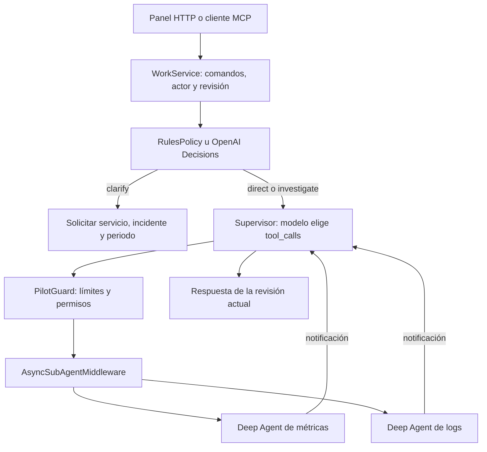

# Piloto ejecutable: supervisor, hijos asíncronos y MCP

Implementación optativa de la alternativa B del [tradeoff](2026-10-22-tradeoff-orquestacion-agentes.md). Permite iniciar un trabajo, observar la selección de herramientas del supervisor, dirigir un hijo mientras trabaja y cancelar el conjunto. HTTP y MCP usan el mismo `WorkService`. El chat/RCA existente conserva su configuración por defecto.

[Recorrido visual paso a paso: chat, HTTP y MCP](flujo-piloto-chat-endpoint.html). HTML independiente con cinco casos que explica la entrada, las decisiones y la respuesta; diferencia el chat ilustrativo de las interfaces implementadas.

## Abrir el panel real

Desde la raíz del repositorio, con Python 3.12:

```powershell
uv sync --all-extras --dev --locked
.venv\Scripts\python.exe examples/demo_supervisor_async.py --serve
```

Abrir **http://127.0.0.1:8012**. El comando inicia Agent Server en `8011` con cuatro trabajos concurrentes y el gateway en `8012`. El panel muestra estado consultado al servidor; el [HTML anterior](simulador-arquitectura-rovo.html) sigue siendo una simulación conceptual independiente.

1. **Iniciar trabajo**: el supervisor devuelve dos hijos con sus `thread_id`.
2. **Repetir comando**: conserva el mismo trabajo sin duplicar la ejecución.
3. **Enviar actualización** mientras trabaja: pide al supervisor actualizar logs a cinco minutos. Observa `update_async_task` en la traza y el cambio de `run_id` del hijo; su `thread_id` se conserva.
4. **Cancelar**: primero registra la solicitud y después verifica la interrupción de padre e hijos. Una respuesta tardía no sustituye la cancelación.
5. **Consultar** por `work_id`: recupera el estado. El navegador conserva únicamente ese identificador para reconectar tras recargar.

El modelo predeterminado es **offline determinista**, indicado en la pantalla y en las trazas. El middleware, SDK, Agent Server, protocolo MCP y ejecución de hijos son reales. Las métricas y logs son **fixtures sintéticos**, incluso al configurar un modelo real. Esta prueba no mide inteligencia del modelo, calidad RCA ni precisión de Decisions.

## Quién decide cada cosa



**Decisions elige la ruta inicial** entre `direct`, `investigate` y `clarify`. No selecciona cada herramienta ni autoriza acciones. **El modelo del supervisor elige las llamadas** `start_async_task`, `update_async_task`, `check_async_task`, `list_async_tasks` y `cancel_async_task`. **PilotGuard valida la ejecución**: actor, revisión, cancelación, plazo, hijos registrados y máximo de dos hijos. Los hijos solo pueden leer su fixture.

MCP expone estas capacidades a otro cliente. No es el cerebro ni el scheduler. La comunicación supervisor–hijos usa el Agent Protocol de LangGraph mediante el middleware de Deep Agents. **No hay un adaptador A2A/Jira ni Temporal en este corte**; su adopción queda condicionada a los criterios del tradeoff.

## Run/Debug y puntos de control

PyCharm incluye tres configuraciones en `.run`:

- **SRE Graph - Async panel**: ejecuta panel y servidor; útil para Run. Para depurar agentes en el subproceso, activa la conexión automática del debugger a subprocesos de Python.
- **SRE Graph - Async Agent Server**: inicia el motor directamente en Debug, puerto `8011`.
- **SRE Graph - Async cliente debug**: con el motor anterior activo, inicia en Debug la secuencia automática de inicio → hijos → actualización → reconexión → resultado.

Las herramientas de supervisor e hijos exigen `ledger_path` en el contexto del run. Un run lanzado desde Studio o con el SDK sin pasar por el gateway recibe `control_unavailable` y no inicia hijos ni lee fixtures.

No ejecutes el panel automático y la configuración independiente del motor en el mismo puerto. Para usar el panel contra un motor ya iniciado:

```powershell
.venv\Scripts\python.exe examples/demo_supervisor_async.py --serve --external-server
```

| Pregunta al depurar | Punto de control | Valores que observar |
|---|---|---|
| ¿Qué ruta escogió? | `work/policy.py`: `RulesPolicy.decide` u `OpenAIDecisionPolicy.decide` | `eligible`, respuesta del SDK, `route`, `confidence`, `fallback_reason` |
| ¿Qué instrucción llega al modelo? | `work/graphs.py`: `PilotGuard.awrap_model_call` | `request.messages`, herramientas disponibles y contexto |
| ¿Qué eligió el agente? | `work/graphs.py`: `PilotGuard.after_model` | Último `AIMessage.tool_calls`: nombre, argumentos e ID |
| ¿Por qué se permite o bloquea? | `work/graphs.py`: `PilotGuard._denial` | Estado `async_tasks`, contexto y control leído del ledger |
| ¿Cómo reproduce decisiones el modo offline? | `work/testing.py`: `OfflinePilotModel._answer` | Mensaje actual, IDs históricos de hijos y notificaciones |
| ¿Quién conserva identidad y revisiones? | `work/service.py`: `start`, `update`, `_dispatch` | `command_id`, `work_id`, `revision`, intención antes de `runs.create` |
| ¿Dónde salen las llamadas HTTP al motor? | `work/engine.py`: `submit` | `context`, metadata del comando y estrategia `enqueue` |
| ¿Dónde trabaja el hijo? | `work/graphs.py`: función `read_fixture` dentro de `_fixture_tool` | Servicio, ventana, revisión y respuesta sintética |
| ¿Por qué todavía no entrega resultado? | `work/service.py`: `_refresh`, `_consolidate` | Estado de hijos, `work_revision`, `result_revision` y resultado de la revisión actual |
| ¿Cómo se confirma la cancelación? | `work/engine.py`: `cancel_tree` | Ejecuciones activas del padre y de hijos encontrados por metadata |

Para entrar al middleware de la biblioteca: `.venv/Lib/site-packages/deepagents/middleware/async_subagents.py`; busca `start_async_task`, `update_async_task` y `_awake_parent`. Es código del proveedor y no se modificó. Las factories se construyen en un thread para evitar I/O bloqueante de Deep Agents en el event loop de Windows.

La traza pública registra elecciones emitidas y argumentos redactados, no razonamiento interno del modelo. En offline no hay inferencia de un proveedor.

## Ejecutar los escenarios por consola

Sin otro gateway activo sobre el mismo ledger:

```powershell
.venv\Scripts\python.exe examples/demo_supervisor_async.py --scenario lifecycle
.venv\Scripts\python.exe examples/demo_supervisor_async.py --scenario cancel
```

El escenario de lifecycle verifica dos hijos, actualización de logs a `5m`, la misma identidad al reconstruir el servicio y respuesta final de revisión 2. `--external-server` permite conservar el motor entre ejecuciones. `--ledger` selecciona otro registro SQLite para una instancia independiente. No ejecutar dos gateways concurrentes contra el mismo ledger: este piloto tiene un solo escritor de comandos.

Los datos y logs locales están en `i/`, excluido de Git. El log del motor es `i/async-pilot-server.log`. Detener el comando que creó el motor detiene también ese subproceso. `langgraph dev` es infraestructura de desarrollo; no se promete recuperación productiva del motor después de una caída.

## Probar MCP de extremo a extremo

Con el panel/servidor activo:

```powershell
.venv\Scripts\python.exe examples/demo_mcp_async.py
```

Se conecta mediante `ClientSession` y Streamable HTTP a **http://127.0.0.1:8012/mcp/**, lista las cuatro herramientas, inicia por MCP, repite por HTTP, dirige logs y cancela por MCP. Comprueba que ambas interfaces observan el mismo trabajo. El transporte es Streamable HTTP en el gateway; no se inicia un segundo servidor stdio.

| Herramienta | Argumentos |
|---|---|
| `work_start` | `{"command":{"command_id":"incidente-1","text":"Investiga pagos"}}` |
| `work_get` | `{"work_id":"UUID devuelto"}` |
| `work_update` | `{"work_id":"UUID","command":{"command_id":"update-1","expected_revision":1,"message":"Actualiza el hijo de logs para revisar últimos 5 minutos"}}` |
| `work_cancel` | `{"work_id":"UUID","command":{"command_id":"cancel-1","expected_revision":2}}` |

HTTP tiene las mismas operaciones en `/work`, `/work/{id}`, `/work/{id}/update` y `/work/{id}/cancel`; los contratos están en `/docs`. El actor proviene de la configuración del gateway y no de argumentos del modelo. Solo loopback, un actor, un proceso; no es una API pública autenticada.

## Activar Decisions y un modelo real

Son dos selecciones independientes: `--policy decisions` usa Decisions para routing; `SRE_ASYNC_MODEL=provider:model` usa un modelo real para supervisor e hijos. Puedes evaluar cada una por separado.

```powershell
# Configura OPENAI_API_KEY en el entorno sin guardarla en Git.
# Sustituye el identificador por un modelo de chat habilitado en tu cuenta.
$env:SRE_ASYNC_MODEL = 'openai:IDENTIFICADOR_DE_TU_MODELO'
.venv\Scripts\python.exe examples/demo_supervisor_async.py --serve --policy decisions
```

El adaptador Decisions usa el SDK público y `gpt-6-luna`. Sin clave da un error explícito de configuración. Timeout, rechazo, respuesta inválida, ruta no elegible o confianza baja producen fallback a reglas. El umbral `0.7` es inicial y **no está calibrado**. Ver [guía Decisions](https://developers.openai.com/api/docs/guides/decisions) y [referencia del SDK](https://developers.openai.com/api/reference/python/resources/decisions/methods/create).

Este entorno no tenía claves de OpenAI/Anthropic. Se probaron los contratos del SDK con transporte HTTP controlado, no llamadas facturables. Falta ejecutar el corpus y medir calidad, latencia, coste y fallbacks antes de decidir el routing de producción.

## Consistencia y alcance comprobable

- Un reintento conserva `command_id`. Otro contenido con ese ID produce conflicto. Si se pierde la respuesta de `runs.create`, se busca metadata antes de reintentar; nunca se reenvía a ciegas. Un despacho que no puede confirmarse permanece explícitamente incierto.
- Una actualización exige `expected_revision`. Un resultado antiguo no se presenta como resultado actual. Si llega una notificación con contexto antiguo o se pierde un aviso, el servicio solicita consolidación al mismo supervisor, sin herramientas y con un máximo de tres intentos por revisión. El comando queda registrado antes de enviarse.
- El resultado observado como `completed` es estable. La cancelación domina cualquier respuesta tardía. Un hijo huérfano terminado se señala como `recovery_required`, en lugar de ocultar el problema o esperar indefinidamente.
- Una aprobación pendiente observada bloquea la actualización. El protocolo de actualización de Deep Agents no ofrece atomicidad entre consultar aprobación y aplicar `interrupt`; no se afirma resolver esa carrera remota para un sistema productivo con aprobaciones.
- El motor instalado y verificado es `langgraph-api 0.13.3`, que avisó fin de soporte. Evaluar la actualización y repetir compatibilidad antes de cualquier despliegue. No se introdujo una actualización mayor del runtime existente dentro de este piloto.

Evidencia de la ejecución, pruebas y revisión: [registro del piloto](../progress/2026-10-22-async-supervisor-pilot.md).
