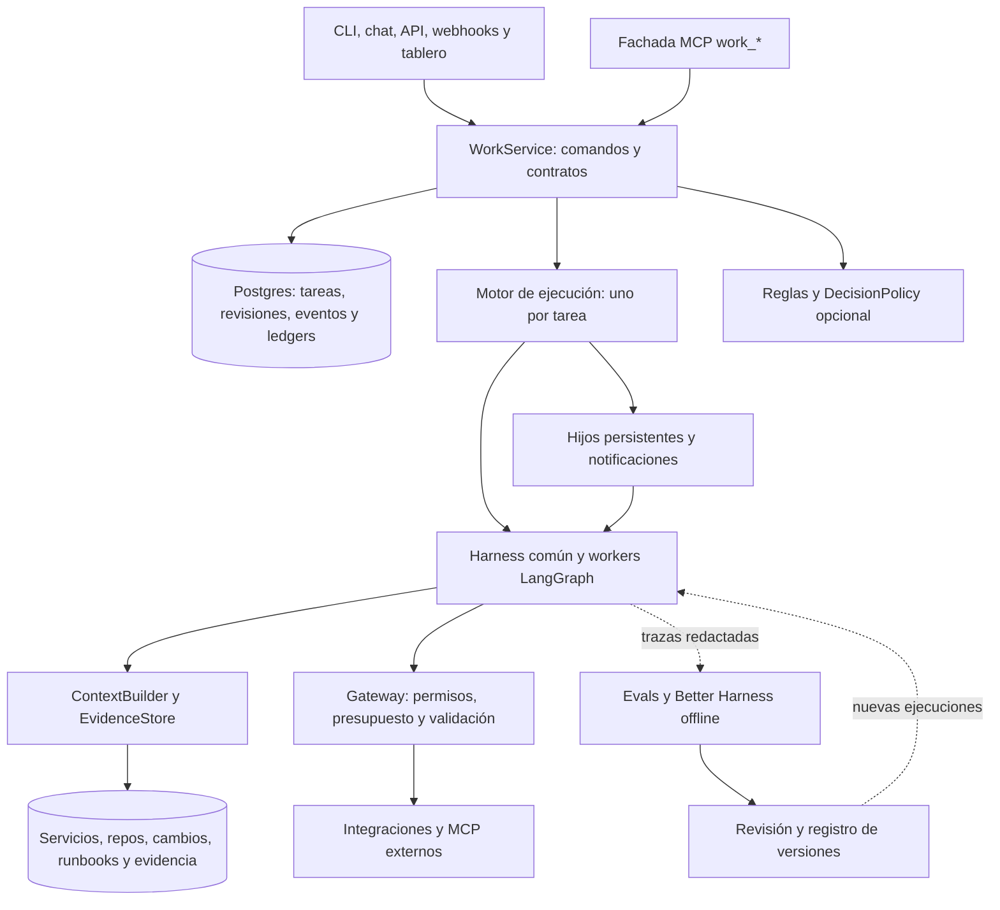

# Evolución de sre-graph hacia una arquitectura inspirada en Rovo

Revisión del 22 de octubre de 2026, realizada después de cerrar la tarea 7 del
[plan del harness](../superpowers/plans/2026-10-21-better-harness-full.md).
Estado: análisis y propuesta de evolución; los componentes futuros descritos aquí
no están implementados ni aprobados para despliegue.

[Tradeoff para decidir la orquestación](2026-10-22-tradeoff-orquestacion-agentes.md):
compara el supervisor actual, hijos asíncronos, Decisions, MCP, A2A y motores de
ejecución, con evidencia de código y criterios para una prueba comparativa.

[Explorar el simulador HTML](simulador-arquitectura-rovo.html): recorrido interactivo
con componentes, presupuesto compartido, recuperación de intentos y aprobación de
acciones. Funciona sin conexión y usa datos ficticios de la arquitectura propuesta.

## Recomendación

Conservar el harness común y LangGraph. El siguiente paso es un **WorkService con
contratos versionados, evidencia recuperable y comandos persistentes**, que adapte
el runtime existente. Después, incorporar hijos con identidad durable, instrucciones
posteriores y notificaciones al padre. La elección entre herramientas directas,
investigación y delegación debe medirse con evals.

La base actual ya resuelve investigación, observación, aprobaciones y evaluación
offline. La distancia hacia el objetivo está en el modelo de trabajo persistente,
el contexto conectado y la continuidad entre ejecuciones. Añadir más especialistas
por sí solo no cubre esas necesidades.

El [PDF de referencia](sre-graph-arquitectura-multiagente.pdf), v2.0, contiene 28 páginas.
Se extrajo su texto completo y se inspeccionaron visualmente los diagramas de las
páginas 4, 7 y 20. El propio documento aclara que no inspeccionó el repositorio.
Esta revisión contrasta sus propuestas con el checkout actual y fuentes oficiales.

## Qué significa «como Rovo»

Hay tres etapas documentadas, que no deben combinarse como si fueran un diseño estático:

| Referencia oficial | Capacidad documentada | Aplicación propuesta a sre-graph |
|---|---|---|
| [Orquestación híbrida, 1 dic 2025](https://www.atlassian.com/blog/blog/atlassian-engineering/how-rovo-embraces-multi-agent-orchestration) | Especialistas por dominio y herramientas directas para consultas sencillas; explica dificultades de planificar todo el DAG al inicio. | Conservar especialización útil y permitir una ruta breve para consultas de estado. |
| [Long Horizon, 17 jun 2026](https://www.atlassian.com/blog/how-we-build/rovo-long-horizon-reasoning-engine) | Un bucle principal con contexto coherente, herramientas disponibles bajo demanda, recuperación de resultados compactados e hijos para investigaciones independientes. | Evitar que cada consulta atraviese un especialista fijo; permitir recuperar evidencia original y comparar un worker transversal con el actual. |
| [Agent autonomy, 26 ago 2026](https://www.atlassian.com/blog/rovo/agent-autonomy) | Separación entre control y ejecución, sandboxes, herramientas mediadas por el servidor, hijos interactivos con handles durables y mejora mediante evals revisadas por ingenieros. | Persistir trabajo e interacción antes de introducir ejecución de código; aislar cómputo pesado y conservar la conversación cuando falla. |

La propuesta de WorkService, sus tablas, Decisions y la elección Postgres/Temporal
son decisiones para **nuestro sistema**. Estas fuentes no establecen que Rovo use
esa combinación concreta ni revelan todo su protocolo interno de consistencia.
Tampoco permiten trasladar sus porcentajes de mejora o latencias a este proyecto.

Jira documenta la activación de agentes por asignación, comentarios y transiciones;
esa interfaz no demuestra exclusión mutua ni ejecución exactamente una vez.
El tablero propio debe representar el estado aceptado por el backend.
[Colaboración con agentes en Jira](https://support.atlassian.com/jira-software-cloud/docs/collaborate-on-work-items-with-ai-agents/).

## Contraste con el código actual

| Área del PDF | Qué existe y dónde comprobarlo | Brecha concreta |
|---|---|---|
| Runtime común, pp. 19–20 | [harness/runtime.py](../../src/sre_graph/harness/runtime.py), [profile.py](../../src/sre_graph/harness/profile.py), [observation.py](../../src/sre_graph/harness/observation.py). Fábrica común, límites, huella y trazas. | La huella cubre nueve superficies; no identifica por sí sola modelo, grafo, esquema de estado, contratos y permisos como una release completa. |
| Contratos de trabajo, pp. 5–7 | [SpecialistTask e InvestigationPlan](../../src/sre_graph/domain/investigation.py) y [contratos de trayectoria de eval](../../src/sre_graph/evals/trajectory.py). | No hay TaskSpec persistida con revisión, criterios de aceptación, dependencias y capacidades concedidas. Los contratos de eval no son contratos de negocio en producción. |
| Motor durable, pp. 13–15 | [RunManager](../../src/sre_graph/server/manager.py), [Storage](../../src/sre_graph/server/storage.py), [scheduler](../../src/sre_graph/scheduler/service.py). Runs, eventos, heartbeat, locks Postgres y reconciliación ya existen. | El dispatch usa tareas asyncio en el proceso. No hay protocolo general de outbox/inbox, intentos con fencing y espera durable de hijos. Los locks actuales no equivalen a ese protocolo. |
| Hijos interactivos, p. 12 | [agents/subagents.py](../../src/sre_graph/agents/subagents.py) espera `ainvoke`; [grafo RCA](../../src/sre_graph/graphs/investigation/graph.py) distribuye especialistas con `Send`. | Paralelismo dentro del grafo, sin handle de hijo persistente, instrucciones posteriores ni notificación durable al padre. La investigación anidada del chat desactiva expresamente el saver heredado. |
| Contexto conectado, p. 11 | [IncidentMemory](../../src/sre_graph/memory/service.py), [EvidenceItem](../../src/sre_graph/domain/evidence.py), runbooks y resultados estructurados. | Memoria resumida y referencias no equivalen a un grafo de servicios/repos/despliegues ni a manifiestos recuperables con ACL y frescura. La clave de evidencia depende de tool/argumentos, no del contenido de cada observación. |
| Catálogo y MCP, p. 10 | [IntegrationRegistry](../../src/sre_graph/integrations/registry.py), [cliente MCP](../../src/sre_graph/integrations/mcp/runtime.py), [selección de tools](../../src/sre_graph/graphs/investigation/extensions.py). | Consumir servidores MCP no expone nuestro WorkService por MCP. Falta la fachada `work_*` y descubrimiento de schemas bajo demanda. |
| Efectos externos, p. 16 | [ActionCatalog y remediación](../../src/sre_graph/graphs/remediation/graph.py), ledger de acciones y [entrega](../../src/sre_graph/delivery/service.py). | Ya hay aprobación, argumentos validados e idempotencia; el resultado incierto exige reconciliación manual. Ampliar identidad por revisión y reconciliación específica por proveedor. |
| Presupuesto, p. 18 | Límites del grafo, middleware y admisión local del manager; evaluación de coste/latencia. | Falta reserva atómica de un presupuesto raíz compartido por hijos, reintentos y herramientas, con conciliación del consumo. |
| Mejora, pp. 20–23 | [experiment.py](../../src/sre_graph/harness/experiment.py), train/holdout/scorecard, allowlist y exportación revisable. | No hay registro de releases con rollout/rollback operativo. El scorecard reutilizado entre campañas no debe presentarse como test final permanentemente sellado. |

La API actual distingue roles y conserva controles de aprobación. Aun así,
[RunContext](../../src/sre_graph/integrations/context.py) no tiene tenant/scopes y
la memoria usa namespaces fijos de organización. Antes de compartir el servicio
entre organizaciones o ámbitos de lectura diferentes, hacen falta autorización
por recurso y aislamiento de memoria, caché, artefactos y resultados. Es un requisito
de esa expansión, no una afirmación de que el producto actual prometa multitenancy.
Atlassian documenta el acceso de agentes en nombre del usuario conforme a sus permisos.
[Permisos y gobierno](https://support.atlassian.com/rovo/docs/rovo-agent-permissions-and-governance/).

## Ajustes que haría al PDF

1. **Actualizar la secuencia de entrega de la p. 26.** Better Harness y el runtime común
   ya existen. Deben acompañar desde el primer cambio de arquitectura. No reconstruirlos
   como una fase futura independiente.
2. **Separar contrato de trabajo y contrato de evaluación.** El primero valida alcance,
   capacidades y aceptación del resultado real; el segundo conoce expectativas del
   escenario congelado. No introducir respuestas de referencia en producción.
3. **Hacer opcional Decisions en el primer corte.** Implementar primero transiciones
   deterministas y un puerto `DecisionPolicy`; añadir el proveedor cuando haya un
   conjunto de decisiones etiquetadas y una mejora medible.
4. **Elegir el motor antes de desarrollar hijos de larga duración.** Mantener Postgres
   y el manager actual para el corte acotado. Para el objetivo de hijos que sobreviven
   turnos y reciben señales, evaluar Temporal antes de construir todo ese motor en SQL.
   La variante Postgres completa es alternativa, no un segundo dueño del mismo trabajo.
5. **Completar el manifiesto de versión de la p. 19.** Identificar artefacto/commit,
   grafo, estado, modelos, tools, contexto, contratos y evaluación. La política de
   reanudación debe rechazar una mezcla incompatible o migrarla explícitamente.
6. **Convertir el aislamiento propuesto en un gate verificable.**
   [execution.py](../../src/sre_graph/harness/execution.py) copia código y hereda el
   entorno del proceso; esto no aísla credenciales productivas ni Python hostil.
   Antes de code mode o candidatos de terceros, usar un entorno mínimo de eval,
   credenciales separadas, restricciones de red y un sandbox real. Preservar los
   jueces y políticas fuera del alcance del candidato.

Decisions existe en la documentación oficial como endpoint tipado con `choice`,
`predicate` y `score`; la guía consultada indica beta pública, `gpt-6-luna` y SDK Python
3.26.0 o posterior. La instalación local tiene `openai==3.26.0` y la superficie
`client.decisions`; se comprobó sin llamadas de red ni credenciales reales.
Eso confirma compatibilidad de superficie, no acceso de la cuenta, rendimiento ni
calidad. Su uso propuesto sigue siendo selección semántica acotada; autorización,
revisión vigente y ejecución permanecen en código.
[Guía oficial de Decisions](https://developers.openai.com/api/docs/guides/decisions).

## Arquitectura objetivo propuesta

Las fronteras son lógicas: WorkService, políticas y contexto pueden empezar en el
mismo backend. La separación de proceso se justifica por durabilidad, capacidad o
aislamiento medidos. Los workers entregan candidatos; el controlador valida y acepta.

Un resultado debe enlazar TaskSpec/revisión, intento, release, evidencia y uso. Separar
`execution_status` de `result_status`: terminar el proceso puede producir un diagnóstico
inconcluso válido, sin declarar causa confirmada ni servicio recuperado. Las acciones
externas conservan un contrato y una autorización propios.

## Orden propuesto de implementación

Las prioridades siguientes corresponden a la evolución futura. No describen trabajo
ya realizado en esta sesión ni sustituyen un diseño detallado de cada entrega.

| Orden | Entrega y módulos | Dependencia | Criterio de aceptación |
|---|---|---|---|
| 1 / P0 | `work/contracts.py`, `work/service.py`, migraciones aditivas y adaptador del RunManager existente. Un contrato `sre.investigate_latency.v1`. | Runtime común disponible. | Mismo command_id no duplica trabajo; revisión obsoleta produce conflicto; resultado inconcluso conserva evidencia y vacíos; API/CLI existentes siguen funcionando. |
| 2 / P0 | `context/manifest.py`, EvidenceStore, release manifest y capacidades concedidas. Reutilizar integraciones y redacción. | Contrato e identidad del trabajo. | Recuperar observaciones originales por referencia; distinguir versiones de la misma consulta; negar lectura fuera de alcance; reanudar sólo con versión compatible. |
| 3 / P1 | Puerto de ejecución durable y primer hijo persistente. Probar Temporal para trabajo largo; mantener el motor previo en tareas antiguas. | Entregas 1–2 y elección explícita de un motor. | Caídas antes/después de dispatch, respuesta perdida, hijo que termina temprano y candidato vencido: no se pierde el despertar ni se sobrescribe el resultado aceptado. |
| 4 / P1 | `DecisionPolicy` y catálogo bajo demanda; comparar ruta directa, grafo actual y worker transversal. Decisions como adaptador evaluable. | Snapshots versionados y dataset de routing. | No invocar LLM en transiciones obligatorias; rechazar selección no elegible o snapshot antiguo; medir abstención, éxito, coste total y p95 con el mismo corpus. |
| 5 / P1 | Fachada MCP y vista de trabajo: estado, contrato, resultado, instrucciones y cancelación. | Comandos idempotentes e hijos durables. | MCP y HTTP ejercen la misma autorización; reconexión recupera eventos; estado muestra revisión, bloqueos, presupuesto y evidencia; no delegar validación a la UI. |
| 6 / P1 | Registro de releases y rollout de lectura, seguido de canary y rollback explícitos. | Evals ampliadas, manifiestos e infraestructura validada. | No promover por smoke; proteger holdout por caso; test final independiente; incidentes activos conservan versión y rollback no altera su estado silenciosamente. |
| 7 / P2 | Code mode aislado y laboratorio Harness², sólo si hay un caso que mejore. | Sandbox, credenciales mínimas, gateway y gates anteriores. | Caer el sandbox no pierde la conversación; herramientas siguen pasando por permisos; el coste adicional se justifica con mejoras locales reproducibles. |

La recomendación de evaluar Temporal para hijos largos se basa en evitar implementar
innecesariamente un segundo sistema completo de ejecución durable. Sus Activities
también requieren idempotencia; adoptar el motor no elimina resultados externos inciertos.
[Workflows](https://docs.temporal.io/workflows) y
[Activities e idempotencia](https://docs.temporal.io/activity-definition).

MCP debe elegirse por interoperabilidad. No atribuirle ahorro de tokens automático ni
usarlo para llamadas internas que una API tipada ya resuelve. La guía de Atlassian
también condiciona CLI/MCP al host y al flujo.
[Guía CLI/MCP](https://support.atlassian.com/rovo/docs/teamwork-graph-cli-and-rovo-mcp-decision-guide/).

## Evals que faltan para decidir la evolución

Preservar los 36 escenarios actuales como regresión y ampliar por familias de tareas:

- Consulta sencilla que debe evitar una investigación completa; falta de contexto
  que requiere abstenerse; comparación de decisiones con varias opciones aceptables.
- Cruce de métricas, logs y cambios con evidencia contradictoria; compacción seguida
  de recuperación del original; observaciones de la misma consulta en momentos distintos.
- Instrucción a un hijo después de que el padre responda; reinicio con padre esperando;
  resultado temprano, duplicado o de un intento obsoleto; cancelación con efecto iniciado.
- Límites compartidos agotados por hijos concurrentes, revocación de acceso, separación
  de tenants y contenido malicioso en tickets, logs o artefactos.
- Fallos entre aceptación y dispatch, commit repetido y despliegue con trabajos pausados.

Mantener separados los tests deterministas de consistencia y las evals con modelos.
Comparar calidad por familia, utilidad de la siguiente acción, citas, coste por incidente
aceptado, latencia p50/p95 y tiempo hasta la primera evidencia útil. Definir umbrales con
baseline real antes del test final. El holdout que influye en selección funciona como
validación; un scorecard consultado para corregir campañas no sigue siendo un test sellado.

## Evidencia y límites de esta revisión

La [validación de la transición](../progress/2026-10-21-better-harness-full.md#cierre-de-la-tarea-7-2026-10-22)
registra 1124 tests Python aprobados, 18 skips de Postgres, 16 tests web y 5 E2E.
El smoke final cubre 19 train, 10 holdout y 7 scorecard y no mide calidad RCA real.
También documenta un fallo intermitente de SQLite al cancelar, reproducido con el
manager original de HEAD. Resolverlo y ejecutar la suite Postgres son pasos de
preparación para la entrega durable; aquí no se atribuye su resolución al harness.

No se ejecutaron integraciones productivas, Decisions ni benchmarks de Rovo. No se
reescribió el producto durante esta revisión. El siguiente corte recomendado es
**contrato de investigación + WorkService + evidencia versionada sobre el runtime
existente**, con un caso vertical y sus pruebas de fallo antes de ampliar a más agentes.

## Implementación posterior de la alternativa B

El [piloto asíncrono ejecutable](2026-10-22-piloto-async-ejecutable.md) aplica ese corte
con supervisor e hijos reales de Deep Agents, WorkService, Decisions opcional e
interfaces HTTP/MCP sobre el mismo gateway. Incluye panel conectado al estado real,
escenarios Run/Debug y pruebas de consistencia. Conserva el RCA como baseline y
explicita que su modelo offline y datos sintéticos no miden calidad de inferencia.
