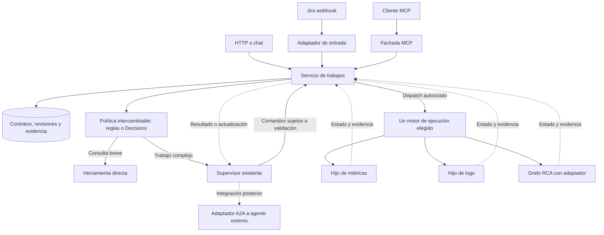

# Tradeoff de arquitectura para el orquestador de Fin Graph

Fecha de evaluación: 22 de octubre de 2026. Decisión propuesta para evolución del producto.

**Recomendación: evolucionar el supervisor existente con hijos asíncronos selectivos y una interfaz MCP sobre un servicio común de trabajos. Evaluar Decisions como política intercambiable; incorporar A2A al conectar un agente externo concreto.** Conservar el grafo RCA y Better Harness. No integrar los dos repositorios de ejemplo como dependencias de producción ni encadenar varios clasificadores para la misma decisión.

La propuesta tiene buen encaje si la investigación debe continuar después de responder al usuario y recibir nuevas instrucciones. Su coste principal está en gestionar estado, resultados y fallos entre ejecuciones. Para consultas breves o procedimientos secuenciales, el sistema actual puede resultar suficiente y más sencillo.

Esta recomendación se apoya en código inspeccionado, documentación primaria y estudios publicados. La combinación Decisions + MCP servidor + Async Deep Agents + A2A **todavía no tiene una prueba integrada ni medidas propias de calidad, coste o latencia**. El simulador HTML y la demo guionizada no constituyen esa evidencia.

## Decisión y supuestos

El objetivo considerado es investigar incidentes SRE, consultar herramientas de observabilidad, mantener la conversación durante tareas largas y permitir que otros asistentes invoquen el servicio. Se presupone que la primera ampliación realiza investigaciones de lectura y conserva las aprobaciones existentes para cambios.

No conocemos todavía el volumen de incidentes, la proporción de consultas breves, los objetivos de latencia, el presupuesto mensual ni las condiciones de despliegue. Por ello, las comparaciones de esfuerzo son relativas al repositorio actual; no son estimaciones de semanas ni una puntuación de rendimiento.

| Decisión | Propuesta | Qué puede cambiarla |
|---|---|---|
| Mantener LangGraph y el harness | Sí; son la base reutilizable. | Una incompatibilidad demostrada con el motor elegido. |
| Mantener un supervisor lógico | Sí; decide el trabajo y sintetiza evidencia. | Un caso real que requiera coordinación entre organizaciones autónomas. |
| Hijos asíncronos | Piloto con dos tareas independientes y largas. | Si el uso real no requiere continuidad entre turnos, mantener delegación esperada. |
| Decisions | Compararlo contra reglas y decisiones del supervisor. | Adoptarlo solo si mejora el objetivo elegido sin degradar calidad. |
| Servidor MCP | Fachada del mismo servicio usado por HTTP y webhooks. | Posponer si solo habrá un consumidor interno y HTTP ya satisface la integración. |
| A2A | Adaptador para agentes externos identificados. | Adelantarlo si Rovo u otro agente externo es requisito de la primera entrega. |
| Smart Intent Router | Referencia de clasificación y selección de modelos. | Reconsiderar adopción si resuelve una necesidad propia y se corrigen sus brechas. |
| Temporal | Alternativa de ejecución durable a comparar cuando sea necesario. | Priorizarlo si ya existe en la organización o hay procesos largos entre varios sistemas. |

## Lo que ya existe

| Evidencia en el repositorio | Implicación para la decisión |
|---|---|
| [Supervisor de chat](../../src/fin_graph/graphs/chat/graph.py): crea especialistas `ask_*`, herramientas directas y un supervisor con LLM. | Ya hay un agente que elige herramientas y delega. No hace falta reconstruirlo para comenzar el experimento. |
| [Delegación a especialistas](../../src/fin_graph/agents/subagents.py): el supervisor espera `await agent.ainvoke(...)`. | Hay delegación durante la ejecución; falta el ciclo de hijo independiente con identidad y seguimiento entre turnos. |
| [Grafo RCA](../../src/fin_graph/graphs/investigation/graph.py): planificación, restricciones y distribución con `Send`. | Ya existe paralelismo. La principal novedad de async sería la interacción y continuidad, no simplemente ejecutar dos consultas a la vez. |
| [RunManager](../../src/fin_graph/server/manager.py): checkpoints, reconciliación, heartbeat y recuperación; dispatch mediante `asyncio.create_task`. | Existe recuperación parcial que debe conservarse. No equivale a un contrato general de trabajos padre e hijo con actualizaciones y resultados versionados. |
| [Cliente MCP](../../src/fin_graph/integrations/mcp/runtime.py) y [prueba de servidor local](../../tests/integrations/test_mcp_loader.py). | Consumir herramientas MCP está implementado. Exponer la investigación como servidor MCP es otra integración. |
| [Runtime común](../../src/fin_graph/harness/runtime.py) y [optimización](../../src/fin_graph/harness/experiment.py). | Las comparaciones deben usar este harness para mantener trazas y restricciones consistentes. |
| [Demo](../../examples/demo_agentes.py) con `DemoServices(ScriptedServices)` y fixtures. | Verifica el flujo y permite depurar estado; no mide selección real de un modelo ni agentes remotos. |

La inspección del entorno encontró `deepagents==0.7.29`, `langgraph==1.2.14`, `langchain==1.4.7`, `langgraph-api==0.13.3`, `langgraph-sdk==0.4.6` y `openai==3.26.0`. [langgraph.json](../../langgraph.json) registra actualmente el grafo `investigation`. Tener paquetes instalados no demuestra un despliegue operativo de supervisor e hijos.

## Separar las decisiones de las capas

| Capa | Responsabilidad | Límite propuesto |
|---|---|---|
| Política de selección | Elegir una ruta entre opciones permitidas usando reglas, Decisions o el supervisor. | No concede permisos ni confirma que una acción externa ocurrió. |
| Supervisor | Entender el objetivo, preparar subtareas, interpretar resultados y pedir contexto. | Respeta capacidades, plazo y presupuesto otorgados por el backend. |
| Servicio de trabajos | Identidad, revisiones, comandos, autorización y aceptación del resultado. | Una sola autoridad de negocio por trabajo. |
| Motor de ejecución | Ejecutar, esperar, reanudar y cancelar intentos. | Un solo dueño del ciclo de ejecución de cada trabajo. |
| Herramientas y conectores | Consultar o actuar sobre sistemas externos. | Mantienen idempotencia y controles por operación. |
| MCP, HTTP, webhooks y A2A | Contratos de acceso y comunicación. | Traducen al servicio común; no crean estados de negocio independientes. |

LangGraph y Deep Agents no son alternativas excluyentes: el segundo incorpora capacidades sobre la pila LangChain/LangGraph. MCP y A2A pueden coexistir, y la distribución de procesos puede coexistir con un supervisor lógico central. La conveniencia de cada frontera depende de quién consume la capacidad y quién opera el sistema.

## Alternativas de arquitectura

Las valoraciones siguientes son inferencias de diseño sobre capacidad y esfuerzo, no resultados medidos.

| Alternativa | Ganancia principal | Coste o limitación | Cuándo elegirla |
|---|---|---|---|
| **A. Mejorar el supervisor y RCA actuales** | Reutilización máxima, pocas piezas nuevas, control conocido. | El padre sigue esperando a sus hijos; interacción limitada durante el trabajo. | Investigaciones acotadas y consultas que caben en una ejecución. |
| **B. Añadir hijos asíncronos selectivos** | Continuar la conversación, dirigir o cancelar hijos y recibir resultados después. | Integración con Agent Server/Agent Protocol, notificaciones, identidad y estado entre ejecuciones. | Objetivo expresado por el usuario: supervisor e hijos interactivos. **Preferida para el piloto.** |
| **C. Incorporar toda la propuesta a la vez** | Routing adicional, federación y varias interfaces desde el inicio. | Mayor superficie de fallo y dificultad para atribuir una mejora a una pieza. | Solo con requisitos concretos para cada integración y capacidad operativa suficiente. |
| **D. Ejecución durable con Temporal y workers LangGraph** | Control explícito de procesos largos, esperas, señales y recuperación entre sistemas. | Nuevo modelo de ejecución, operación y adaptación de llamadas a Activities. | Procesos prolongados o una plataforma Temporal ya disponible. |

B y D comparan principalmente quién gestiona la ejecución. En una primera entrega no pondría ambos a reintentar o reanudar el mismo trabajo. MCP y la política de selección pueden mantenerse iguales al comparar motores.

También conviene incluir un agente con herramientas directas como control experimental en consultas sencillas. Aunque la arquitectura elegida sea multiagente, no todas las solicitudes necesitan hijos.

## Decisions y Smart Intent Router

La guía oficial de **Decisions** documenta respuestas `choice`, `predicate` y `score`. Al consultar, estaba en beta pública y admitía `gpt-6-luna`. La selección entre categorías tiene un encaje distinto de generar un plan o argumentos para herramientas. La API también puede devolver una negativa; la aplicación debe tratarla explícitamente. [Guía](https://developers.openai.com/api/docs/guides/decisions), [respuesta de la API](https://developers.openai.com/api/reference/python/resources/decisions/methods/create).

Para Fin Graph probaría una selección como `consulta_directa`, `investigacion_rca`, `investigacion_async` o `pedir_contexto`. El código prepara las opciones elegibles según herramientas, permisos y presupuesto. El resultado se vincula a la revisión del trabajo; antes de ejecutar se comprueba que sigue vigente. Las transiciones obligatorias —por ejemplo, detenerse al agotar el presupuesto— permanecen en código.

| Política a comparar | Ventaja potencial | Coste o fallo relevante |
|---|---|---|
| Reglas explícitas | Sin inferencia adicional para comandos conocidos; fácil auditoría. | Mantenimiento de casos y mala cobertura de lenguaje ambiguo. |
| Supervisor con tool calling | Puede elegir y preparar argumentos en el mismo turno. | Mayor variabilidad; puede gastar una llamada compleja en una decisión sencilla. |
| Decisions antes del supervisor | Puede evitar activar un flujo costoso en solicitudes clasificables. | Añade una dependencia; una ruta errónea puede ahorrar tokens y empeorar el resultado. |
| Decisions consultado después por el supervisor | Útil si la decisión necesita evidencia recién obtenida. | Si el supervisor ya puede decidir, la consulta adicional puede ser redundante. |
| Router de modelos por capacidades y disponibilidad | Controla modelo, límite y proveedor sin reinterpretar el objetivo. | Exige comprobar equivalencia de herramientas, calidad y condiciones de cada ruta. |

No encadenaría Smart Router y Decisions para volver a clasificar la misma intención. Sí podría existir una política subordinada para elegir un modelo compatible después de haber elegido el trabajo. Si Decisions falla o se abstiene, el fallback debe estar definido y conservar el objetivo y los controles; el routing y la recuperación del trabajo son decisiones distintas. [Guía de OpenAI sobre routing y recuperación](https://developers.openai.com/blog/designing-failover-across-openai-model-providers).

La probabilidad emitida por un modelo no sustituye una calibración local. Ajustaría los umbrales con casos etiquetados, incluyendo solicitudes ambiguas y varias rutas aceptables. No fijaría un `0.8` universal ni permitiría que una confianza alta apruebe una remediación.

### Lo que demuestra el repositorio Smart Intent Router

En el commit `103d267361c149ba5eeb4422d27a101b2a0e3bf0`, el [clasificador](https://github.com/vika4433/smart-intent-router/blob/103d267361c149ba5eeb4422d27a101b2a0e3bf0/smart-intent-router-server/src/intent_classifier/intent_classifier.py) combina palabras clave y una consulta a LM Studio. El [selector base](https://github.com/vika4433/smart-intent-router/blob/103d267361c149ba5eeb4422d27a101b2a0e3bf0/smart-intent-router-server/src/llm_selector/llm_selector.py) aplica reglas y ordena candidatos por pesos configurados. Esto no demuestra optimización aprendida del coste por incidente.

Existe además una ruta con un bucle de orquestación por IA; por tanto, tampoco es correcto describir todo el proyecto como un simple `if`. Sin embargo, el [entrypoint principal](https://github.com/vika4433/smart-intent-router/blob/103d267361c149ba5eeb4422d27a101b2a0e3bf0/smart-intent-router-server/src/mcp_server/server.py#L2097) inicia FastAPI y deja desactivado el servidor MCP. El [archivo LICENSE](https://github.com/vika4433/smart-intent-router/blob/103d267361c149ba5eeb4422d27a101b2a0e3bf0/LICENSE) está vacío en esa revisión: habría que aclarar los términos antes de incorporar código.

**Decisión:** adoptar la idea de separar clasificación y selección de modelo; implementar la política mínima sobre nuestras interfaces y evaluaciones. No importar su aplicación web, almacenamiento y segundo orquestador para obtener esa capacidad.

## Hijos asíncronos y coste de adaptación

Async Deep Agents permite crear tareas, consultar su estado, enviar instrucciones y cancelarlas sobre Agent Protocol. La actualización crea otra ejecución en el mismo hilo e interrumpe la anterior; no es una edición instantánea del pensamiento de un agente. Las notificaciones automáticas se documentan en beta. [Ciclo de vida oficial](https://docs.langchain.com/oss/python/deepagents/async-subagents).

Actualizar un hijo que espera entrada descarta su solicitud pendiente. El servicio debe distinguir una respuesta a una aprobación de una revisión del trabajo, para que una instrucción posterior no sustituya accidentalmente una aprobación. [Espera de entrada en hijos](https://docs.langchain.com/oss/python/deepagents/async-subagents#handle-subagents-waiting-for-input).

Hay una oportunidad de reutilización: `AsyncSubAgentMiddleware` es un middleware para agentes y no obliga por sí mismo a reemplazar todo el supervisor por `create_deep_agent`. Pero el código instalado en 0.7.29 separa la gestión del padre del aviso de terminación del hijo. `create_deep_agent` añade `_ParentNotifierMiddleware`; un hijo personalizado requiere una integración equivalente. La API privada con guion bajo no debería convertirse en dependencia estable de nuestro producto.

Puntos inspeccionados en la distribución instalada: `deepagents/middleware/async_subagents.py` para lanzamiento y resultados; `deepagents/middleware/_parent_notifier.py` para notificación; `deepagents/graph.py` para composición. El [código upstream](https://github.com/langchain-ai/deepagents/tree/main/libs/deepagents/deepagents) debe contrastarse con la versión fijada: copiar una firma de `main` o del ejemplo sin verificarla puede mezclar APIs distintas.

El [repositorio Async Deep Agents solicitado](https://github.com/langchain-ai/async-deep-agents) ilustra supervisor, investigador y programador. Su README conserva nombres como `launch_async_subagent`, mientras la versión instalada utiliza `start_async_task`. Sirve como ejemplo de interacción; para la prueba hay que fijar conjuntamente versión del paquete, SDK, servidor y contrato de herramientas.

En 0.7.29, el SDK usado por la cancelación tiene `wait=False` por defecto y el notificador puede registrar un fallo de entrega sin propagarlo. Por eso la solicitud de cancelación no demuestra que cesaron todos los efectos, y una notificación no debe ser el registro autoritativo del incidente. El servicio debe reconciliar el estado por identificadores y descartar resultados de intentos vencidos.

| Ruta de integración | Ganancia | Precio que introduce |
|---|---|---|
| Supervisor actual + middleware async + adaptadores explícitos | Conserva herramientas, restricciones y comportamiento conocido. | Hay que implementar y probar notificación, mapeo de estados y contexto. |
| `create_deep_agent` para supervisor e hijos | Recibe un conjunto integrado de capacidades del harness. | Hay que revisar herramientas, middleware y contexto añadidos para evitar duplicación con lo existente. |
| Otro agente LLM que envuelva el RCA como herramienta | Adaptación rápida al formato de conversación. | Otra decisión sobre si ejecutar RCA, posibles repeticiones y reformulación del informe. |

El RCA actual recibe `raw_alert` y produce `report`; el protocolo de hijos espera mensajes y obtiene una respuesta conversacional. Hace falta un adaptador de entrada y salida. Añadir otro LLM únicamente para traducir estos formatos resulta difícil de justificar. También hay que conservar las referencias a evidencia y evitar que un hijo y su padre entreguen dos veces el mismo informe. [Estado RCA](../../src/fin_graph/graphs/investigation/state.py), [entrega del grafo](../../src/fin_graph/graphs/investigation/graph.py).

El adaptador debe definir además qué significa actualizar RCA: su `intake` reinicializa parte del estado. Hay que elegir entre iniciar una investigación con entrada completa revisada o continuar desde un estado compatible. Reutilizar un hilo no basta para garantizar continuidad de la evidencia.

El supervisor actual transmite un `RunContext` de Python con clientes. Al pasar a otro run, incluso codesplegado mediante ASGI, cada worker deberá reconstruir sus clientes y verificar la identidad autorizada. Transferir solo contexto serializable autorizado; no guardar objetos de clientes ni secretos en el historial. [Contexto actual](../../src/fin_graph/integrations/context.py).

El middleware estándar llama al SDK directamente. Su integración debe hacer que inicio, actualización y cancelación atraviesen los controles del servicio común, mediante adaptadores o validación en el servidor. `async_tasks` será el seguimiento del supervisor; no otra autoridad sobre el estado de negocio.

**Decisión:** comparar primero integración mínima y harness completo con las mismas herramientas. Elegir por comportamiento observable y mantenimiento. Un `await` no impide paralelismo del event loop; la limitación relevante es que el padre espera el resultado dentro de su turno.

## MCP y A2A como interfaces

MCP puede exponer la investigación como herramienta, aunque internamente haya varios agentes. La especificación consultada, `2026-07-28`, contempla además una extensión Tasks opcional para operaciones largas. Su uso exige soporte de cliente y servidor. Sería incorrecto justificar A2A afirmando que MCP solo admite trabajo síncrono. [Especificación MCP](https://modelcontextprotocol.io/specification/2026-07-28), [negociación de Tasks](https://tasks.extensions.modelcontextprotocol.io/specification/2026-07-28/tasks#capability-negotiation).

La interfaz mínima propuesta es `work_start`, `work_get`, `work_update` y `work_cancel`. Son nombres de herramientas de negocio, no nombres de métodos obligatorios del protocolo. Si el cliente soporta Tasks, un adaptador puede exponer seguimiento y resultados del mismo trabajo. El backend conserva la identidad y el resultado al desconectarse el cliente.

El mapeo requiere cuidado: `tasks/update` responde a entradas solicitadas pendientes; no equivale a enviar cualquier nueva instrucción mediante `work_update`. Asimismo, confirmar `tasks/cancel` no garantiza que la ejecución termine cancelada. Mantener la actualización de negocio separada y verificar la cancelación efectiva. [Actualización](https://tasks.extensions.modelcontextprotocol.io/specification/2026-07-28/tasks#task-update-requests), [cancelación](https://tasks.extensions.modelcontextprotocol.io/specification/2026-07-28/tasks#task-cancellation).

A2A interesa al delegar a un sistema que opera otro equipo y expone sus propios agentes. Antes de integrarlo deben acordarse versiones, identidad, estados, artefactos y cancelación. **Un endpoint A2A no es directamente una URL de AsyncSubAgent**, que espera Agent Protocol. [Comparación oficial de A2A y MCP](https://a2a-protocol.org/latest/topics/a2a-and-mcp/).

El Gateway de Rovo documenta A2A `0.3.0`, OAuth y streaming; fuerza `pushNotifications=false` y `stateTransitionHistory=false`. No hay que trasladar automáticamente a esa interfaz las capacidades del harness interno de Rovo. La Agent Card del entorno objetivo determina las capacidades anunciadas. [Arquitectura del Gateway](https://developer.atlassian.com/cloud/rovo-a2a/architecture/).

La integración requiere OAuth con PKCE, registro dinámico de cliente y habilitación administrativa. La llamada síncrona puede cortarse alrededor de los 30 segundos en el CDN; las tareas largas deben considerar streaming. Esto añade trabajo de conexión y operación que el ejemplo Jira A2A no resuelve por nosotros. [Inicio de Rovo A2A](https://developer.atlassian.com/cloud/rovo-a2a/getting-started/), [manejo de tareas](https://developer.atlassian.com/cloud/rovo-a2a/architecture/#task-handling).

### Qué tomar de Jira A2A

El repositorio está archivado. En el commit `35b15fb31ffe276a405c8890c4f32f02166709a6`, el [agente de entrada](https://github.com/tuannvm/jira-a2a/blob/35b15fb31ffe276a405c8890c4f32f02166709a6/internal/agents/jiraretrieval.go#L82) recibe el webhook, obtiene el ticket y lanza una goroutine. El [servidor común](https://github.com/tuannvm/jira-a2a/blob/35b15fb31ffe276a405c8890c4f32f02166709a6/internal/common/server.go#L48) usa un gestor de tareas en memoria. Ese recorrido enseña integración entre agentes, pero no demuestra recuperación durable al reiniciar.

Tomaría la separación entre ingesta, enriquecimiento y análisis. Para Fin Graph propondría registrar el evento antes de confirmarlo, deduplicar su identificador y separar el resultado de investigación del comentario que se entrega a Jira. Así un reintento de entrega no necesita repetir toda la investigación ni generar un ciclo de comentarios y webhooks.

## Elección del motor de ejecución

Un checkpoint conserva estado del grafo; un protocolo de tareas define cómo conversar sobre el trabajo; el motor debe resolver cuándo ejecutarlo y recuperarlo. La existencia de los dos primeros no demuestra el tercero bajo todas las condiciones de fallo.

| Motor | Encaje | Coste que debe incluirse en la decisión |
|---|---|---|
| Manager actual y persistencia existente | Menor cambio para tareas acotadas y recuperación ya implementada. | Extenderlo hacia un motor general exige comandos persistentes, correlación padre/hijo, manejo de intentos obsoletos y notificación recuperable. |
| Agent Server compatible con Agent Protocol | Camino directo para probar Async Deep Agents. | Operar o contratar el servidor y comprobar almacenamiento, autenticación, límites y requisitos de la edición elegida. Un servidor local de desarrollo no es la validación productiva. |
| Temporal | Procesos con esperas largas, señales y coordinación de varios sistemas. | Servicio y workers adicionales; código de workflow determinista y llamadas externas como Activities. Los efectos externos siguen necesitando idempotencia. |

El despliegue standalone oficial de Agent Server usa PostgreSQL y Redis, sin exigir todo el control plane de LangSmith. La guía requiere claves de API/licencia y salida a `beacon.langchain.com` salvo modalidad air-gapped; desaconseja scale-to-zero por riesgo de pérdida de tareas. Estas condiciones pertenecen a esa distribución del servidor, no al protocolo ni a la biblioteca LangGraph en general. [Requisitos standalone](https://docs.langchain.com/langsmith/deploy-standalone-server).

Tracing, telemetría de uso y verificación de licencia son aspectos distintos: desactivar trazas no implica eliminar las demás comunicaciones. Deben confirmarse las condiciones y el precio aplicables al despliegue elegido antes de presupuestarlo. [Data plane y licenciamiento](https://docs.langchain.com/langsmith/data-plane).

Temporal conserva la ejecución de workflows y separa Activities para trabajo externo; sus reintentos no garantizan que un proveedor externo ejecute una acción una sola vez. [Workflows](https://docs.temporal.io/workflows), [Activities e idempotencia](https://docs.temporal.io/activity-definition).

**Decisión condicional:** probar B con Agent Server si su despliegue encaja. Si los requisitos operativos o comerciales no encajan, o ya disponemos de Temporal, comparar D antes de construir un scheduler general propio en SQL. El servicio de trabajos puede conservar contratos de negocio en ambos casos; el motor elegido conserva el estado de ejecución.

## Qué aporta la evidencia externa

El estudio *Towards a Science of Scaling Agent Systems*, versión 3 del 8 de abril de 2026, compara 260 configuraciones sobre seis benchmarks. Encuentra que la utilidad de coordinar agentes depende de la estructura de la tarea y que las tareas secuenciales o intensivas en herramientas pueden sufrir sobrecoste. Sus límites incluyen conjuntos pequeños en algunos benchmarks y sensibilidad al diseño experimental. No proporciona una predicción de mejora para nuestros incidentes. [Estudio y limitaciones](https://arxiv.org/html/2512.08296v3).

Anthropic describe beneficios al dividir búsquedas independientes y costes adicionales de tokens, coordinación y despliegue. Sus resultados son de investigación, con modelos y tareas propios; no sirven como multiplicador presupuestario de Fin Graph. La lección aplicable es comprobar que cada hijo tiene un objetivo independiente y entrega evidencia recuperable. [Experiencia de ingeniería](https://www.anthropic.com/research/multi-agent-research-system).

Rovo describe una evolución hacia herramientas directas y contexto coherente para evitar pérdidas al transferir trabajo, junto con hijos independientes cuando el trabajo necesita aislamiento y continuidad. Esto favorece una arquitectura híbrida, con delegación selectiva. No establece que Rovo utilice Decisions, Temporal o los repositorios estudiados. [Long Horizon](https://www.atlassian.com/blog/how-we-build/rovo-long-horizon-reasoning-engine), [autonomía y harness](https://www.atlassian.com/blog/rovo/agent-autonomy).

## Coste y latencia que hay que comparar

El coste por incidente debe incluir supervisor, routing, hijos, herramientas, reintentos, infraestructura y trabajo operativo. Además del coste medio, mediría el **coste total dividido por investigaciones aceptadas**, incluyendo lo consumido por ejecuciones fallidas.

Para Decisions, la tarifa consultada es USD 0,10 por millón de tokens de entrada, sin cobro de salida; pueden aplicar recargos regionales y de contexto largo. [Tarifa del endpoint](https://developers.openai.com/api/docs/guides/decisions#pricing-and-availability).

Ejemplo aritmético, no previsión de uso: 100.000 trabajos al mes × 2 decisiones × 2.000 tokens × USD 0,10 / 1.000.000 = **USD 40 al mes de routing**, antes de recargos. No incluye supervisor, hijos, operaciones ni errores de clasificación. La frase comercial sobre velocidad de Decisions no demuestra que el incidente completo se resuelva más rápido.

Para comparar un router nuevo con la ruta actual puede usarse esta condición de ahorro:

```text
q × coste de trabajo realmente evitado
    > coste incremental del router
      + coste esperado de errores adicionales
      + coste operativo adicional por solicitud
```

`q` es la fracción de solicitudes en las que el nuevo router evita trabajo que **la versión actual sí habría ejecutado**. No debe contarse como ahorro una ruta breve que el supervisor ya elegía correctamente.

El paralelismo reduce tiempo de pared cuando las subtareas son independientes, pero no reduce necesariamente sus tokens. Para dos tareas independientes, el tiempo de ejecución puede acercarse al máximo de ambas duraciones más coordinación; si la segunda depende de la primera, esa aproximación no aplica. Separar siempre tiempo hasta el acuse de recibo, primera evidencia útil y resultado aceptado: devolver un identificador rápido no demuestra una investigación más rápida.

## Prueba comparativa para decidir

Primero conservar la regresión existente. Después ampliar con incidentes representativos y entradas ambiguas, sin reutilizar los casos empleados para ajustar prompts como test final. No basta ejecutar fixtures para medir decisiones de un modelo real.

| Experimento | Variable que cambia | Qué permite decidir |
|---|---|---|
| E0 | Supervisor/RCA actuales, con modelo real y herramientas de prueba controladas. | Línea base de calidad, coste y latencia. |
| E1 | Mismo comportamiento, política de routing por reglas o Decisions. | Si el selector evita trabajo y cuánto pierde por rutas erróneas. |
| E2 | Misma política y especialistas; ejecución esperada o hijos async. | Beneficio de continuidad e interacción separado del beneficio de routing. |
| E3 | Dos formas de integración async: middleware mínimo o harness Deep Agent completo. | Coste de adaptación frente a mantenimiento de capacidades añadidas. |
| E4 | Mismo servicio por HTTP y por MCP con un cliente objetivo. | Compatibilidad, permisos y recuperación al reconectar. |
| E5 | Un agente externo real por A2A, solo si aporta una capacidad requerida. | Valor de federación y compatibilidad de estados y versiones. |

En E0–E3 mantener modelos, herramientas, datos y presupuesto comparables. Repetir casos para estimar variabilidad, alternar el orden de ejecución para reducir sesgos de carga y separar resultados por familia. Evaluar también con un presupuesto mayor cuando se quiera medir capacidad máxima, dejando claro que es otra comparación.

| Familia | Ejemplo | Resultado que debe observarse |
|---|---|---|
| Consulta breve | Estado actual de un servicio conocido. | Respuesta respaldada sin iniciar una investigación innecesaria. |
| Ambigüedad | “Está lento” sin servicio ni ventana temporal. | Petición de contexto o abstención razonable. |
| Investigación independiente | Métricas y logs del mismo incidente. | Evidencia útil de ambos y síntesis que conserva contradicciones. |
| Dependencia secuencial | Buscar logs usando una versión identificada primero en despliegues. | Orden correcto; el paralelismo no inventa datos faltantes. |
| Instrucción posterior | El usuario cambia la ventana temporal mientras trabaja un hijo. | Misma identidad del trabajo, nueva revisión y resultado anterior marcado como obsoleto. |
| Fallos | Reinicio, timeout, resultado duplicado o llegada tardía tras cancelación. | Recuperación trazable y una única aceptación vigente. |
| Límites | Dos hijos agotan presupuesto o una credencial pierde acceso. | Controles aplicados por el backend; estado y resultado parciales explícitos. |

Las trazas para depurar deben mostrar entrada redactada, opciones elegibles, respuesta de Decisions o `tool_calls`, versión de política, revisión del trabajo, identificadores de padre/hijo/intento, consumo y resultado aceptado. Eso permite inspeccionar decisiones observables; no requiere exponer razonamiento privado de un modelo.

### Criterios de adopción propuestos

- **Corrección y control:** ninguna acción sin autorización, ninguna aceptación de resultado obsoleto, ninguna creación duplicada del trabajo lógico y ninguna aceptación o efecto externo duplicado en las pruebas de fallo. Los intentos pueden repetirse durante recuperación. Son condiciones del ensayo, no una garantía universal por haber pasado tests.
- **Calidad:** fijar antes del ensayo el margen de no inferioridad por familia; revisar manualmente casos críticos y medir abstenciones correctas y afirmaciones sin evidencia.
- **Economía:** comparar coste por resultado aceptado y carga operativa. Adoptar un router si aporta una mejora relevante frente al mejor baseline comparable.
- **Interacción:** comprobar instrucciones posteriores, cancelación y recuperación entre turnos; esta capacidad puede justificar async aunque el coste aumente.
- **Latencia:** registrar p50/p95 con tamaño de muestra e incertidumbre. Un piloto pequeño orienta, pero no certifica un SLO de producción.
- **Operación:** demostrar recuperación tras reinicio y despliegue con trabajos activos en el motor elegido, usando versiones fijadas.

Si E1 no aporta ventaja, conservar el supervisor sin Decisions. Si E2 no aporta interacción útil, conservar la ejecución esperada. Si MCP no tiene un consumidor que lo necesite, mantener HTTP. Estas salidas deben ser resultados válidos del experimento.

## Arquitectura recomendada para el piloto



Las fronteras del diagrama son responsabilidades; no obligan a crear un microservicio por caja. Durante el piloto pueden coexistir el manager actual para trabajos antiguos y un motor nuevo para trabajos del experimento, con una asignación inequívoca por identificador.

La primera demostración debe cubrir un incidente, dos hijos, una instrucción posterior y un reinicio. Decisions debe poder activarse y desactivarse sobre ese mismo caso. MCP debe invocar el mismo contrato que HTTP. A2A se añade al identificar una tarea que el agente externo resuelva mejor o que solo él pueda realizar.

**Decisión sugerida hoy: avanzar con B como experimento acotado; mantener A como baseline y ruta de retorno. Evaluar Decisions por separado, y posponer la combinación completa C. Elegir D si los requisitos de continuidad o la plataforma existente lo justifican.**

| Si cambia esta condición | Cambia la recomendación |
|---|---|
| Predominan consultas cortas y no hay instrucciones entre turnos. | A puede ser suficiente; probar routing sin añadir un nuevo motor. |
| Se necesita dirigir o cancelar investigaciones mientras se conversa. | B tiene una ventaja funcional concreta que medir. |
| Predominan aprobaciones largas y procesos entre varios sistemas, o Temporal ya está operado. | D gana prioridad frente a desarrollar recuperación propia. |
| No se permite salida al proveedor de Decisions. | Excluir ese adaptador y conservar reglas o una política compatible con el despliegue permitido. |
| La primera entrega exige delegación a Rovo. | Adelantar el adaptador A2A y su prueba de compatibilidad; mantenerlo separado del ciclo de los hijos internos. |
| Agent Server no encaja en condiciones comerciales u operativas. | Comparar otro servidor compatible o D, incluyendo el coste real de construir y mantener la alternativa. |

## Evidencia y alcance de la revisión

Se inspeccionó el árbol de trabajo local, que contiene cambios sin commit; los enlaces locales corresponden a ese estado. Las referencias a Jira A2A y Smart Intent Router fijan los commits revisados. Las páginas de producto describen la información publicada al consultar y pueden cambiar.

La revisión verificó versiones instaladas mediante metadatos y leyó código y pruebas existentes. No ejecutó llamadas a Decisions, incidentes productivos, despliegues de Agent Server o Temporal ni una federación A2A. Las mediciones y criterios anteriores describen el experimento pendiente.

Antecedente: [revisión de arquitectura y diferencias respecto a Rovo](2026-10-22-revision-rovo.md). Demostración conceptual existente: [simulador HTML](simulador-arquitectura-rovo.html).
